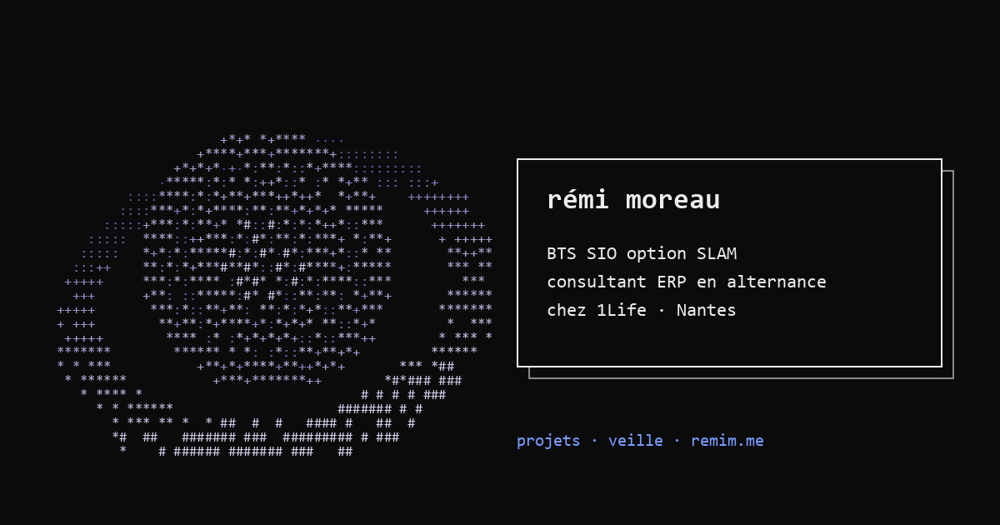

# Portfolio de Rémi Moreau — BTS SIO SLAM



Portfolio de **Rémi Moreau**, étudiant en BTS SIO option SLAM à MyDigitalSchool Nantes (promo 2026-2028), en alternance chez 1Life (groupe Visiativ) comme consultant ERP Open-Prod.

**En ligne : https://remim.me**

**Réalisé avec [Claude Code](https://claude.com/claude-code).** Mon rôle : définir le besoin, faire les choix et tester.

Un thème « terminal minimal » : fond presque noir, une seule police à chasse fixe (IBM Plex Mono), tout en minuscules, une colonne de 720 px. L'accueil montre une sphère de particules ASCII animée et une carte de présentation ; les projets sont classés en trois sections (en formation, en entreprise, perso), chacun avec le même gabarit court. Un terminal caché permet de parcourir le site comme un système de fichiers.

## Sommaire

- [Démarrer en local](#démarrer-en-local)
- [Ce que fait le site](#ce-que-fait-le-site)
- [Modifier le contenu](#modifier-le-contenu)
- [Architecture](#architecture)
- [Veille automatique](#veille-automatique)
- [Veille par e-mail](#veille-par-e-mail)
- [Tableau de bord des synthèses](#tableau-de-bord-des-synthèses)
- [Mettre en ligne sur remim.me (GitHub Pages)](#mettre-en-ligne-sur-remimme-github-pages)
- [Autre option : héberger sur le homelab (Docker + nginx)](#autre-option--héberger-sur-le-homelab-docker--nginx)
- [Étapes de construction](#étapes-de-construction)
- [Crédits et licences](#crédits-et-licences)

## Démarrer en local

Prérequis : **Node.js 22.22.2 ou 24.15 au minimum** (version conseillée : 24 LTS, indiquée dans `.nvmrc`) et **Git**. Sous Windows : `winget install OpenJS.NodeJS.LTS Git.Git`, puis rouvrir le terminal.

**Garder le projet hors d'un dossier synchronisé** (iCloud Drive, OneDrive…) : la synchronisation bloque `npm install`. Sur chaque ordinateur, cloner le dépôt dans un dossier local, puis se synchroniser avec `git pull` et `git push` :

```bash
git clone https://github.com/moreauremi/moreauremi.github.io.git portfolio
cd portfolio
npm install      # installe les outils du projet (à faire une fois)
npm run dev      # lance le site en local, rechargé à chaque modification
npm run build    # fabrique la version finale, 100 % statique, dans dist/
npm run preview  # sert le contenu de dist/ pour vérifier le build
npm run lint     # vérifie le code : JavaScript (ESLint) et CSS (Stylelint)
npm test         # teste le site construit (dist/) : HTML valide, CSP, liens, gabarit
npm run check    # les trois à la suite : lint, build, test (comme avant chaque publication)
```

`npm run dev` affiche l'adresse à ouvrir (par défaut http://localhost:5173). Avec `npm run dev`, les fiches en brouillon sont visibles (marquées « brouillon ») et chaque `[À COMPLÉTER]` est surligné en jaune ; le site publié n'affiche ni l'un ni l'autre.

## Ce que fait le site

| Adresse | Contenu |
|---|---|
| `/` | sphère de particules ASCII (noyau dense, anneau incliné) et carte : nom, formation et alternance, activité, ville |
| `/projets/` | trois sections : en formation, en entreprise (1Life), perso ; dans chacune, l'applicatif (dev, SQL, paramétrage ERP) avant l'infra |
| `/projets/<fiche>/` | la fiche : même gabarit, plus documents, illustrations et mention de l'IA |
| `/formations/` | formations suivies chez 1Life, badges |
| `/veille/` | méthode, puis pour chaque sujet : pourquoi, mes synthèses, dernières actualités |
| `/contact/` | e-mail, GitHub, LinkedIn, CV, formulaire |
| `/mentions-legales/` | éditeur, hébergeur, données personnelles |

**Gabarit d'une réalisation**, le même partout : titre ; une phrase de résumé (20 mots au plus) ; contexte en une ligne ; « ce que j'ai fait » en 3 puces au plus ; compétences en tags ; liens (fiche, GitHub, démo). Le build refuse une fiche qui ne le respecte pas.

**Terminal caché** : touche `` ` `` (ou `²` sur un clavier AZERTY), ou Ctrl+Alt+T. `help` liste les commandes (`ls`, `cd`, `cat`, `open`…), Échap ou `exit` le ferme. Son code n'est téléchargé qu'à la première ouverture.

**Animation** : la sphère tourne à 30 images par seconde au plus, se met en pause quand l'onglet est caché ou qu'elle sort de l'écran, et reste figée si le système demande de réduire les animations (`prefers-reduced-motion`).

**Anciennes adresses** du site RémiOS (`#/realisations/glpi`, `/realisations/glpi/`, `#/veille/cybersecurite`…) : renvoyées vers les nouvelles pages.

## Modifier le contenu

| Quoi | Où |
|---|---|
| Carte de l'accueil, contact, CV, formations et badges, mention de l'IA, sujets de veille | `content/site.config.js` |
| Une réalisation | `content/realisations/<fiche>.md` (le gabarit est expliqué en tête de `glpi.md`) |
| Introduction de la veille | `content/pages/veille.md` |
| Un sujet de veille | `content/veille/<sujet>/sujet.md` (pourquoi), `syntheses.md` (mes synthèses), `actualites.json` (écrit chaque lundi) |

Règles d'écriture : minuscules, sauf noms propres et sigles ; phrases courtes ; rien d'inventé. Une information manquante s'écrit `[À COMPLÉTER : …]`. Une fiche avec `brouillon: true` n'est pas publiée.

Pour 1Life, rester général sur l'environnement technique : ne nommer ni machine, ni mode d'accès, ni outil ou script interne (un test le vérifie).

## Architecture

Chaque page est une vraie page HTML, fabriquée au build à partir des fichiers Markdown et de la configuration. Le navigateur ne reçoit que du HTML, du CSS et un peu de JavaScript (sphère, terminal, mesure d'audience), sans bibliothèque ni ressource extérieure.

```
content/                 le contenu (Markdown, configuration, actualités)
index.html               cadre commun à toutes les pages (head, police, CSS, JS)
plugins/
  vite-plugin-content.js fabrique les pages (dev : à la demande ; build : dans dist/)
  content/site.js        lit et vérifie tout le contenu
  content/realisation.js vérifie une fiche (gabarit court)
  content/pages.js       gabarits des pages
  content/seo.js         référencement, plan du site, robots.txt
  content/csp.js         politique de sécurité du contenu (pages et nginx)
src/
  main.js                JS commun : anciennes adresses, sphère, terminal, audience
  sphere.js              sphère de particules ASCII
  terminal/terminal.js   terminal caché (module virtual:site-data pour le contenu)
  styles/site.css        thème
404.html, 403.html, 503.html   pages d'erreur
test/                    tests du site construit et des scripts de veille
```

Les liens internes sont relatifs (`../projets/`) : le site fonctionne à la racine d'un domaine comme dans un sous-dossier (version Docker). Une politique de sécurité stricte (CSP) n'autorise que les fichiers du site ; elle est identique dans les pages et dans `docker/security-headers.conf` (le build vérifie les deux).

## Veille automatique

### Principe

```
Chaque lundi        pour chaque sujet :             IA (GitHub Copilot)       content/veille/<sujet>/
GitHub Actions ──►  flux RSS du sujet, articles ──►  choisit les plus utiles, ──►  actualites.json ──► site republié
(veille.yml)        des 10 derniers jours,          les résume, met des tags
                    filtrés par mots-clés
```

- **Trois sujets**, collectés au même moment, l'un après l'autre : **Cybersécurité** (la cybersécurité des PME industrielles, 13 sources dont le CERT-FR), **Intelligence artificielle** (usages, risques et encadrement de l'IA en entreprise, 11 sources dont ActuIA et la CNIL) et **Facturation électronique** (la réforme 2026-2027, 13 sources dont la FNFE-MPE, Service-public.fr et DAF Magazine). IOPOLE n'a pas de flux RSS : ses actualités sont captées par mot-clé dans les autres sources.
- `.github/workflows/veille.yml` lance `scripts/veille.mjs` chaque lundi vers 7 h, puis enregistre les fichiers d'actualités dans le dépôt et relance la publication du site. Un sujet en échec (IA indisponible…) n'empêche pas les autres d'être enregistrés. La première collecte d'un nouveau sujet remonte à 30 jours au lieu de 10, pour démarrer avec du contenu.
- Le sujet, les mots-clés, les tags proposés, les sources et le modèle d'IA se règlent dans `content/site.config.js`, rubrique `veille`.
- La page `veille/` a une section par sujet : pourquoi je l'ai choisi, **mes synthèses** (texte personnel, dans `content/veille/<sujet>/syntheses.md`, écrit depuis le [tableau de bord des synthèses](#tableau-de-bord-des-synthèses) ou à la main), puis les **5 dernières actualités**. `veille/#<sujet>` mène directement à un sujet.

### Choix et garde-fous

- **Sources** : uniquement les flux RSS publiés par les médias eux-mêmes (ANSSI, Cybermalveillance.gouv.fr, LeMagIT…), faits pour être repris. Google Actualités et Bing Actualités ont été écartés : leurs conditions interdisent toute utilisation hors d'un lecteur RSS personnel.
- **Pas d'invention** : l'IA résume le texte de l'article (récupéré sur la page quand le flux ne donne qu'une phrase), jamais le titre seul. Le titre, la source, la date et le lien viennent du flux, jamais de l'IA.
- **Tags cohérents** : l'IA choisit d'abord parmi les tags existants du sujet (`tags` du sujet et ceux déjà attribués) ; deux écritures d'un même tag (accents, majuscules) sont fusionnées.
- **Sécurité** : le texte venu des flux et de l'IA est toujours échappé à l'affichage, seules les adresses `http(s)` deviennent des liens, et le build vérifie le fichier : une entrée incomplète arrête la publication, le site en ligne reste intact. Le jeton de l'IA n'est jamais dans le code, seulement dans les secrets GitHub.
- **IA : GitHub Copilot**, appelé par Copilot CLI (2 requêtes par sujet et par semaine, plus une par reformulation demandée depuis le tableau de bord), avec l'abonnement Copilot du compte (gratuit pour les étudiants vérifiés par GitHub Education). Copilot CLI est un agent capable de lancer des commandes : ici, il n'a droit à aucun outil (ni shell, ni écriture, ni serveur MCP), travaille dans un dossier vide, et le jeton d'écriture du dépôt n'est pas sur le disque pendant qu'il tourne. Un article piégé ne peut donc rien lui faire exécuter. GitHub Models, prévu au départ, a été fermé le 30 juillet 2026.

### Mise en route (une seule fois)

1. Avoir GitHub Copilot sur son compte : https://github.com/settings/copilot (gratuit pour les étudiants vérifiés par GitHub Education).
2. Créer un jeton : https://github.com/settings/personal-access-tokens/new (jeton *fine-grained*). Propriétaire : son **compte personnel** (pas une organisation). Expiration : 1 an. Dans les permissions du compte (**Account permissions**), ajouter **Copilot Requests**, et rien d'autre : aucun accès aux dépôts. **Generate token**, puis copier le jeton.
3. Sur GitHub, dépôt `moreauremi.github.io` → **Settings → Secrets and variables → Actions → New repository secret**. Nom : `COPILOT_GITHUB_TOKEN`, valeur : le jeton. Il n'est plus jamais affiché ensuite.
4. Onglet **Actions → Veille automatique → Run workflow** pour lancer une première collecte sans attendre lundi. Le site est à jour quelques minutes plus tard.

Le jeton expire au bout d'un an : en créer un nouveau et remplacer la valeur du secret (GitHub prévient par e-mail avant l'expiration).

### En local

```bash
npm run veille -- --sans-ia     # collecte seulement : vérifie les flux et les mots-clés
npm run veille -- --sans-ia --sujet intelligence-artificielle   # un seul sujet
npm install -g @github/copilot  # une fois : installe Copilot CLI, puis `copilot login`
npm run veille                  # collecte complète, écrit content/veille/<sujet>/actualites.json
```

### Dépannage

- **« Copilot CLI a échoué »** : jeton expiré ou sans la permission « Copilot Requests », abonnement Copilot inactif, ou quota épuisé. Le message complet est dans le journal de la tâche (onglet Actions). « Authentication failed » ou « Bad credentials » : le plus souvent, la permission **Copilot Requests** manque au jeton (dans *Account permissions*, pas dans *Repository permissions*) ; l'ajouter avec **Edit** sur la page du jeton ne change pas sa valeur, le secret reste bon. Vérifier aussi que le secret `COPILOT_GITHUB_TOKEN` contient bien ce jeton, et pas celui du relais Gmail (cas rencontré le 12 octobre 2026).
- **Version de Copilot CLI** : fixée dans les trois workflows (`veille.yml`, `reformuler.yml`, `veille-mail.yml`), pour qu'une nouvelle version ne change pas le comportement sans prévenir. Pour en changer, modifier le numéro dans les trois, puis lancer une collecte à la main pour vérifier.
- **Choisir le modèle** : `veille.ia.modele` (vide = modèle par défaut de Copilot). Les noms possibles sont listés par `copilot --help` (option `--model`).
- **Changer de fournisseur d'IA** (Mistral, Groq, Gemini…) : `veille.ia.fournisseur: 'api'`, avec `url` et `modele` du service (tous proposent l'API au format OpenAI), et leur clé dans le secret utilisé par `veille.yml`.
- **Un flux ne répond plus** : la tâche continue avec les autres et le signale dans son journal. Le retirer ou corriger son adresse dans les `flux` du sujet.
- **Une actualité hors sujet ou un résumé faux** : bouton **Hors sujet** du tableau de bord. L'actualité quitte la liste `actualites` (elle disparaît du site) pour la liste `horsSujet` du même fichier, où elle reste, avec sa date d'écartement : l'onglet « Hors sujet » du tableau de bord permet de la retrouver et de la remettre. La collecte ne la reproposera pas. À la main : déplacer l'entrée de `actualites` vers `horsSujet` dans `content/veille/<sujet>/actualites.json`, puis envoyer le changement (`git push`).
- **Rappel des synthèses** : chaque lundi, après la collecte, `scripts/rappel-syntheses.mjs` lit la date de la dernière synthèse de chaque sujet (dans son titre, `19/01/2027 - …`). Un sujet sans synthèse, ou sans rien depuis 21 jours, ouvre une issue « Veille : synthèses à écrire » qui vous mentionne (e-mail de GitHub) ; elle est relancée chaque lundi par un commentaire, et se ferme toute seule quand tous les sujets sont à jour. Bilan sans rien envoyer : `node scripts/rappel-syntheses.mjs --essai`.
- **Ajouter un sujet** : un nouvel élément dans `veille.sujets` (identifiant, nom, mots-clés, sources…), un dossier `content/veille/<id>/` avec `sujet.md` et `syntheses.md` (copier ceux d'un autre sujet), puis l'ajouter à la liste des sujets du tableau de bord (`config.js` du dépôt `veille-syntheses`). La première collecte se fait au lundi suivant, ou tout de suite avec **Run workflow**.

## Veille par e-mail

Chaque lundi, les nouvelles actualités arrivent aussi par e-mail, numérotées. J'y réponds avec mon avis sur celles qui m'ont marqué ; l'IA le met en forme de synthèse, sans rien y ajouter, et me la renvoie à relire. Je réponds « ok » et elle est publiée, exactement comme depuis le [tableau de bord](#tableau-de-bord-des-synthèses).

### Principe

```
Lundi       veille.yml ──► scripts/veille-mail.mjs --annonce ──► version (release) brouillon « veille-mail-… » :
                                                                 actualités numérotées, e-mail à envoyer
                                                                               │
Toutes les  relais Gmail (apps-script/veille-mail.js, dans mon compte Google) ◄┘
            (le relais lance aussi veille.yml le lundi vers 7 h, voir ci-dessous)
10 minutes  envoie l'e-mail ──► je réponds ──► il range ma réponse dans le brouillon et lance veille-mail.yml
                                                                               │
            scripts/veille-mail.mjs ◄──────────────────────────────────────────┘
              « 1, 3 : mon avis… »  ──► l'IA (Copilot) met mon avis en forme ──► e-mail de relecture
              « ok »                ──► un commit par synthèse (syntheses.md) ──► site republié ──► e-mail « publié »
```

Le site n'a pas de serveur pour recevoir des e-mails, et GitHub Actions non plus. Le relais est donc un petit script **Google Apps Script**, qui tourne gratuitement dans mon compte Google : il envoie les e-mails préparés et attend mes réponses. Tout le reste (lecture de ma réponse, IA, publication) se fait dans GitHub Actions, comme la collecte et la reformulation. Comme pour la reformulation, une version brouillon de ce dépôt sert de boîte aux lettres entre les deux.

### Répondre

- **À l'e-mail des actualités** : une ligne par synthèse, qui commence par les numéros des actualités dont elle parle (du même sujet), puis mon avis, sur une ou plusieurs lignes. Le texte avant la première ligne de numéros (« Salut, ») est ignoré. « rien » : pas de synthèse cette semaine.
  ```
  1, 3 : NIS2 va coûter cher aux PME, mais moins qu'une attaque. Chez nos clients…
  7 : Proxmox devient une vraie alternative à VMware…
  ```
- **À l'e-mail de relecture** : « ok » publie tout, « ok 1 » seulement la synthèse 1, « annule » abandonne. Tout autre texte est une correction, appliquée par l'IA à toutes les synthèses, ou à une seule si elle commence par son numéro (« 2 : enlève la dernière phrase »). Une nouvelle relecture suit.
- **Après une erreur** (IA indisponible…) : un e-mail le dit ; « réessaie » relance avec la même réponse.
- Une réponse mal formée (numéro inconnu, sujets mélangés, avis trop court) n'est jamais devinée : un e-mail explique quoi corriger, et il suffit de répondre à nouveau.

### Choix et garde-fous

- **Mon texte, pas celui de l'IA** : sa consigne est de garder mes idées, mes exemples, mes conclusions et la première personne, sans ajouter d'avis ni d'expérience, et de ne reprendre que les faits des résumés. Un avis de moins d'une phrase est refusé. La page « Veille technologique » le dit (méthode).
- **Rien n'est publié sans mon « ok »**, et je relis le texte exact qui sera publié, titre daté compris.
- **Même format que le tableau de bord** : titre « JJ/MM/AAAA - … », bloc « Sources » avec les liens des actualités (tirés du fichier d'actualités, jamais de l'IA), même message de commit. Le rappel des synthèses et le tableau de bord voient donc ces synthèses comme les autres. Une tâche relancée ne publie jamais deux fois la même synthèse.
- **Confidentialité** : mon avis et les brouillons restent dans la version brouillon, visible seulement des personnes qui peuvent écrire dans le dépôt, et ne sont jamais écrits dans les journaux du workflow (publics).
- **Sécurité** : le relais ne lit que les fils qu'il a ouverts, et seulement mes propres messages. Son jeton GitHub est limité à ce dépôt (versions et lancement des workflows) et rangé dans les propriétés du script, jamais dans le code. Le workflow refuse toute version qui n'est pas un brouillon d'échange (tag `veille-mail-…` ou titre « Veille par e-mail du … » : GitHub remplace le tag d'un brouillon modifié par `untagged-…`), Copilot travaille sans aucun outil et n'hérite pas du jeton du dépôt, et le texte des flux, de l'IA et de mes réponses est échappé dans les e-mails.
- **Ménage** : un échange encore ouvert 21 jours après son e-mail est abandonné, et son brouillon supprimé le lundi suivant.
- **Collecte lancée par le relais** : la tâche programmée de GitHub (`schedule`) n'est pas garantie : le 12 octobre 2026, la collecte prévue à 7 h 17 est partie à 15 h 16, et le 19 octobre elle n'était pas partie à 8 h 45. Le relais lance donc lui-même `veille.yml` chaque lundi vers 7 h (déclencheur `collect`, fiable à 15 minutes près), sauf si une collecte a déjà réussi ou tourne depuis 6 jours. La tâche programmée reste en secours ; si elle passe après, elle ne trouve rien de nouveau et n'envoie pas de deuxième e-mail.

### Mise en route du relais Gmail (une seule fois)

1. **Jeton GitHub du relais** : https://github.com/settings/personal-access-tokens/new (jeton *fine-grained*, à part de celui du tableau de bord : chacun se révoque séparément). Propriétaire : son compte personnel. Expiration : 1 an. **Repository access** : *Only select repositories* → `moreauremi.github.io`. **Repository permissions** : **Contents** et **Actions** en *Read and write*, rien d'autre. **Generate token**, puis copier le jeton.
2. **Projet Apps Script** : https://script.google.com → **Nouveau projet**, le nommer « Relais veille RémiOS ». Remplacer tout le contenu de `Code.gs` par celui de `apps-script/veille-mail.js`, puis enregistrer.
3. **Jeton dans le projet** : **Paramètres du projet** (roue dentée) → **Propriétés du script** → **Ajouter une propriété** : nom `GITHUB_TOKEN`, valeur : le jeton. Enregistrer.
4. **Installation** : retour à l'**Éditeur**, choisir la fonction `install` dans la liste en haut, puis **Exécuter**. Google demande l'autorisation de lire et d'envoyer des e-mails et de contacter un service externe (GitHub). L'avertissement « Google n'a pas validé cette application » est normal pour un script personnel : **Paramètres avancés → Accéder à Relais veille RémiOS (non sécurisé) → Autoriser**. Le journal affiche « Relais installé… » : le relais vérifie désormais toutes les 10 minutes, et lance la collecte le lundi vers 7 h. Après chaque mise à jour du code du relais, relancer `install`.
5. **Essai sans attendre lundi** : sur GitHub, onglet **Actions → Veille par e-mail → Run workflow**, avec `essai`. Un e-mail des 3 dernières actualités de chaque sujet arrive dans les 10 minutes. Pour ne rien publier, répondre ensuite « annule ».

Les e-mails partent de mon propre compte, expéditeur « RémiOS veille » : ils arrivent non lus dans la boîte de réception, sous le libellé « Veille RémiOS ».

### Dépannage

- **Pas d'e-mail le lundi** : sans nouvelle actualité, pas d'e-mail. Sinon, vérifier que la collecte a tourné (**Actions → Veille automatique**), qu'un brouillon « Veille par e-mail du … » existe (**Releases**), puis l'onglet **Exécutions** du projet Apps Script (fonction `collect` vers 7 h, puis `check`). Pour ne pas attendre : **Actions → Veille automatique → Run workflow**.
- **Erreurs du relais** : elles sont dans **Exécutions** du projet Apps Script, et Google envoie un résumé par e-mail. « GitHub a répondu 401 » : jeton expiré ou révoqué, en créer un nouveau et remplacer la propriété `GITHUB_TOKEN`.
- **Erreur de la tâche** (IA indisponible, quota…) : un e-mail le signale, le détail est dans **Actions → Veille par e-mail**. Une tâche qui ne répond pas en 45 minutes est aussi signalée par le relais.
- **Mettre le relais en pause** : projet Apps Script → **Déclencheurs** → supprimer les déclencheurs `check` et `collect`. Relancer `install` pour les remettre.

## Tableau de bord des synthèses

Un tableau de bord privé, **https://dashboard.remim.me**, pilote le portfolio. Sa **vue d'ensemble** montre l'état de chaque veille (dernière synthèse, actualités à traiter, dernière collecte), le résultat de la dernière publication et de la dernière collecte, et les visites du site. Sa vue **Synthèses** sert à écrire les synthèses de chaque sujet : choix du sujet, liste, ajout, modification, suppression, aperçu, actualités à citer en sources, et **Reformuler avec l'IA** sur un passage sélectionné. Chaque enregistrement est un commit de `content/veille/<sujet>/syntheses.md` sur `main`, qui republie le site. Le code de la page, sa mise en route (DNS, jeton) et ses choix de sécurité sont dans son propre dépôt : [moreauremi/veille-syntheses](https://github.com/moreauremi/veille-syntheses).

La page est statique (GitHub Pages) et n'a pas de serveur pour appeler l'IA. La reformulation passe donc par un workflow de **ce** dépôt, qui réutilise l'IA et le secret de la veille :

```
dashboard.remim.me ──► version (release) brouillon ──► workflow reformuler.yml ──► scripts/reformuler.mjs ──► réponse écrite
                    de ce dépôt, avec le passage    (lancé par la page)          Copilot (scripts/ia.mjs)    dans le même brouillon,
                                                                                                             lue puis supprimée par la page
```

- Un brouillon n'est visible que des personnes qui peuvent écrire dans le dépôt : le passage ne devient jamais public, et il n'est jamais écrit dans les journaux du workflow (publics, comme le dépôt).
- Le workflow n'a que le droit `contents: write` (lire et modifier le brouillon), refuse toute version qui n'est pas un brouillon `reformulation-…`, et Copilot n'hérite pas du jeton du dépôt.
- Les exécutions réussies sont supprimées par la page au passage ; les échouées restent, pour lire leur journal (onglet **Actions → Reformulation**).

Le fichier reste du Markdown ordinaire : on peut toujours le modifier à la main. Penser alors à `git pull` d'abord, puisque le tableau de bord enregistre directement sur GitHub (sinon `git push` est refusé : `git pull --rebase`, puis `git push`).

## Mettre en ligne sur remim.me (GitHub Pages)

### Principe

```
Code sur GitHub ──push──► GitHub Actions ──► GitHub Pages ──► https://remim.me
(moreauremi.github.io)    fabrique et          héberge le site,
                          vérifie le site      fournit le HTTPS
```

- Le code est dans le dépôt GitHub `moreauremi/moreauremi.github.io`.
- À chaque envoi (`push`) sur la branche `main`, le workflow `.github/workflows/deploy.yml` installe les outils, fabrique le site (ce qui vérifie aussi les fiches) et publie le dossier `dist/`. Si une fiche est mal remplie, la publication s'arrête et le site en ligne reste intact.
- Le domaine `remim.me`, obtenu gratuitement chez Namecheap grâce au GitHub Student Pack, pointe vers les serveurs de GitHub Pages.

### Réglages à faire une seule fois (sur github.com)

1. Ouvrir le dépôt `moreauremi.github.io`, puis **Settings → Pages**.
2. Dans **Build and deployment → Source**, choisir **GitHub Actions** (et non « Deploy from a branch »).
3. Dans **Custom domain**, vérifier que `remim.me` est indiqué (sinon le saisir, puis **Save**).
4. Cocher **Enforce HTTPS**. La case devient cliquable une fois le certificat délivré : de quelques minutes à 24 h après la configuration du domaine.

État au 26 septembre 2026 : source GitHub Actions, domaine `remim.me` et **HTTPS forcé** (`http://remim.me` redirige vers `https://remim.me`).

### DNS chez Namecheap (déjà en place)

**Domain List → remim.me → Manage → Advanced DNS** :

| Type | Host | Value |
|---|---|---|
| A Record | `@` | `185.199.108.153` |
| A Record | `@` | `185.199.109.153` |
| A Record | `@` | `185.199.110.153` |
| A Record | `@` | `185.199.111.153` |
| CNAME Record | `www` | `moreauremi.github.io.` |

Ces adresses sont celles des serveurs de GitHub Pages. Vérification depuis un terminal : `dig +short remim.me` doit afficher les quatre adresses.

**Important pour `www`** : l'enregistrement CNAME `www` doit pointer vers `moreauremi.github.io.`, pas vers `remim.me.`. Sinon, GitHub ne met que `remim.me` dans le certificat HTTPS, et `https://www.remim.me` affiche une alerte « connexion non sécurisée ». Après correction, GitHub ajoute `www.remim.me` au certificat, de quelques minutes à quelques heures plus tard. Si rien ne change au bout de 24 h, retirer puis ressaisir `remim.me` dans **Settings → Pages → Custom domain** relance la demande de certificat. Vérification : `curl -I https://www.remim.me` doit répondre `301` vers `https://remim.me/`.

### Première mise en ligne

Le projet est déjà relié au dépôt GitHub (`git remote -v` affiche `origin`). Une fois le réglage « Source : GitHub Actions » fait, il suffit d'envoyer le code :

- **dans VS Code** : onglet **Contrôle de code source** (icône des branches), bouton **Synchroniser les modifications** ou **Publier la branche** ; VS Code demande de se connecter à GitHub la première fois ;
- **ou dans un terminal** : `git push -u origin main`.

Suivre la publication dans l'onglet **Actions** du dépôt (1 à 2 minutes), puis ouvrir https://remim.me. Le lien à donner au jury : **https://remim.me**.

Le dépôt est public : le code, le README et le CV sont visibles sur GitHub, comme ils le sont déjà sur le site. Le dossier `a-integrer/` (documents de travail) est exclu de git et n'est jamais publié.

### Mettre à jour le site

Modifier une fiche ou la configuration, vérifier en local avec `npm run dev`, faire un commit, puis envoyer (Synchroniser dans VS Code, ou `git push`). Le site est à jour une à deux minutes plus tard.

## Autre option : héberger sur le homelab (Docker + nginx)

Le projet contient aussi tout le nécessaire pour héberger le site sur le homelab, avec des en-têtes de sécurité complets envoyés par nginx. Utile pour une démonstration technique à l'oral ; le site public, lui, est sur GitHub Pages.

### Principe

```
Navigateur ──► reverse proxy nginx du homelab ──► conteneur « remios-portfolio »
                (HTTPS, nom de domaine)              nginx:alpine + le dossier dist/
                                                     port 80 du conteneur = port 8080 de la machine
```

Le `Dockerfile` construit l'image en deux étapes (*multi-stage*) : une image Node fabrique le site, puis seul le dossier `dist/` est copié dans une image `nginx:alpine`. L'image finale ne contient ni Node, ni le code source : elle est légère et expose le minimum.

| Fichier | Rôle |
|---|---|
| `Dockerfile` | construction de l'image (build Node → service nginx), vérification de santé |
| `docker/nginx.conf` | service du site : gzip, cache d'un an sur les fichiers hashés, `index.html` jamais en cache, pages d'erreur 403 et 404 du site à la place de celles de nginx |
| `docker/security-headers.conf` | en-têtes de sécurité (CSP stricte, anti-clickjacking, nosniff…) |
| `docker-compose.yml` | lancement : port 8080, redémarrage automatique, lecture seule, pas d'élévation de privilèges |
| `.dockerignore` | fichiers non envoyés à Docker (node_modules, dist, .git…) |

### Étape 1 : copier le projet sur le serveur

Prérequis sur le serveur : Docker et son plugin compose (`docker compose version` doit répondre).

Depuis le Mac, dans le dossier du projet (remplacer `remi@homelab` par l'utilisateur et l'adresse du serveur) :

```bash
rsync -av --exclude node_modules --exclude dist ./ remi@homelab:~/remios-portfolio/
```

L'image est construite sur le serveur lui-même : peu importe que ce soit un PC (amd64) ou un Raspberry Pi (arm64), les images `node:24-alpine` et `nginx:alpine` existent pour les deux.

### Étape 2 : construire et lancer le conteneur

```bash
ssh remi@homelab
cd ~/remios-portfolio
docker compose up -d --build
```

### Étape 3 : vérifier

```bash
docker ps                          # STATUS doit passer à « (healthy) » au bout de 30 s
curl -I http://localhost:8080/     # HTTP/1.1 200 OK + en-têtes de sécurité
docker compose logs -f             # journaux de nginx (Ctrl+C pour quitter)
```

Depuis un autre poste du réseau local : `http://<adresse-IP-du-homelab>:8080`.

Pour vérifier la compression : `curl -sI -H "Accept-Encoding: gzip" http://localhost:8080/ | grep -i content-encoding` doit afficher `gzip`.

### Étape 4 : brancher le reverse proxy nginx

Le reverse proxy nginx du homelab tourne **dans un conteneur Docker**. Attention : à l'intérieur de ce conteneur, `127.0.0.1` désigne le conteneur nginx lui-même, pas la machine. Il y a deux façons de joindre le portfolio ; choisir l'une des deux, puis utiliser l'adresse obtenue à la place de `<PORTFOLIO>` dans les exemples plus bas.

**Option A, la plus simple : l'adresse IP de la machine.** Le portfolio publie le port 8080 sur la machine, que le conteneur nginx peut joindre par l'adresse IP locale du homelab (`hostname -I` sur le serveur pour la connaître). `<PORTFOLIO>` vaut alors par exemple `192.168.1.10:8080`.

**Option B, plus propre : un réseau Docker commun.** Les deux conteneurs se parlent directement, sans passer par un port de la machine.

1. Trouver le réseau du conteneur nginx (remplacer `nginx` par le nom de son conteneur, visible avec `docker ps`) :

   ```bash
   docker inspect nginx --format '{{range $nom, $r := .NetworkSettings.Networks}}{{$nom}} {{end}}'
   ```

2. Ajouter à la fin de `docker-compose.yml` (remplacer `nom-du-reseau` par le résultat de la commande) :

   ```yaml
   networks:
     default:
       name: nom-du-reseau
       external: true
   ```

3. Relancer : `docker compose up -d`. `<PORTFOLIO>` vaut alors `remios-portfolio:80` (le nom du conteneur sert d'adresse). La ligne `ports:` peut rester, pour tester directement sur le port 8080.

**Sans nom de domaine** (situation actuelle) : publier le site dans un sous-dossier de l'adresse du homelab, par exemple `http://192.168.1.10/portfolio/`. Dans le bloc `server` existant de la configuration nginx :

```nginx
# « /portfolio » sans barre finale → redirection vers « /portfolio/ »
location = /portfolio {
    return 301 /portfolio/;
}

location /portfolio/ {
    # Le « / » final retire « /portfolio/ » avant de transmettre au conteneur
    proxy_pass http://<PORTFOLIO>/;
    proxy_set_header Host $host;
    proxy_set_header X-Real-IP $remote_addr;
    proxy_set_header X-Forwarded-For $proxy_add_x_forwarded_for;
    proxy_set_header X-Forwarded-Proto $scheme;
}
```

Ça fonctionne sans rien changer au site grâce aux chemins relatifs (`base: './'`). Vérifier puis recharger la configuration (remplacer `nginx` par le nom du conteneur) :

```bash
docker exec nginx nginx -t && docker exec nginx nginx -s reload
```

**Avec un nom de domaine** (plus tard) :

```nginx
server {
    listen 80;
    server_name portfolio.exemple.fr;
    return 301 https://$host$request_uri;
}

server {
    listen 443 ssl;
    http2 on;
    server_name portfolio.exemple.fr;

    ssl_certificate     /etc/letsencrypt/live/portfolio.exemple.fr/fullchain.pem;
    ssl_certificate_key /etc/letsencrypt/live/portfolio.exemple.fr/privkey.pem;

    # HTTPS obligatoire pendant un an (à mettre ici : c'est le proxy qui gère le HTTPS)
    add_header Strict-Transport-Security "max-age=31536000" always;

    location / {
        proxy_pass http://<PORTFOLIO>;
        proxy_set_header Host $host;
        proxy_set_header X-Real-IP $remote_addr;
        proxy_set_header X-Forwarded-For $proxy_add_x_forwarded_for;
        proxy_set_header X-Forwarded-Proto $scheme;
    }
}
```

Puis renseigner `urlPublique: 'https://portfolio.exemple.fr/'` dans `content/site.config.js` et reconstruire (étape 5) : les aperçus de lien (image, adresse) seront alors complets.

**Page de maintenance (503)** : quand le conteneur est arrêté (mise à jour, redémarrage), le reverse proxy ne peut plus le joindre et affiche sa propre page « 502 Bad Gateway ». Pour afficher à la place la page de maintenance du site :

1. Copier la page dans un dossier de la machine que le conteneur du reverse proxy peut lire (un dossier monté en volume, ici `~/nginx/pages`, visible sous `/usr/share/nginx/pages` dans ce conteneur). La page est autonome : un seul fichier suffit. À refaire si la page change.

   ```bash
   docker cp remios-portfolio:/usr/share/nginx/html/503.html ~/nginx/pages/portfolio-503.html
   ```

2. Dans le bloc `location` qui contient `proxy_pass` (sous-dossier ou nom de domaine), ajouter :

   ```nginx
   # Conteneur arrêté ou injoignable : page de maintenance du site, avec le code 503
   error_page 502 503 504 =503 /portfolio-503.html;
   ```

   et, à côté de ce bloc :

   ```nginx
   location = /portfolio-503.html {
       root /usr/share/nginx/pages;   # dossier monté dans le conteneur du reverse proxy
       internal;                      # jamais servie en accès direct
   }
   ```

3. Recharger la configuration (commande ci-dessus), puis tester : `docker stop remios-portfolio`, ouvrir le site (page de maintenance, code 503), puis `docker start remios-portfolio`.

### Étape 5 : mettre à jour le site

Après une modification (nouvelle fiche, captures…), depuis le Mac :

```bash
rsync -av --exclude node_modules --exclude dist ./ remi@homelab:~/remios-portfolio/
ssh remi@homelab "cd ~/remios-portfolio && docker compose up -d --build && docker image prune -f"
```

`docker image prune -f` supprime les anciennes versions de l'image.

### Dépannage

- **Le port 8080 est déjà pris** : `PORTFOLIO_PORT=8090 docker compose up -d` (et adapter `proxy_pass`).
- **Le build échoue** : lire le message, il indique souvent une fiche mal remplie ; le corriger et relancer. Le même message apparaît en local avec `npm run build`.
- **Le conteneur redémarre en boucle** : `docker compose logs`. Si nginx se plaint d'un système de fichiers en lecture seule, mettre en commentaire les lignes `read_only`, `tmpfs` et leurs dossiers dans `docker-compose.yml`, puis relancer.
- **Seul le reverse proxy doit accéder au conteneur** : utiliser l'option B (réseau Docker commun) et supprimer la ligne `ports:` ; le site n'est alors plus joignable directement depuis le réseau.

## Étapes de construction

Le projet a été construit en 12 étapes, une par commit git (`git log --oneline` pour les voir) :

1. Initialisation du projet (Vite, git, configuration de base)
2. Police auto-hébergée et thème RémiOS (remplacé à l'étape 19)
3. Contenu en Markdown et fiches d'exemple
4. Menu principal et navigation
5. Fiches de réalisation et visionneuse d'images
6. Vue rapide jury imprimable
7. Séquence de démarrage
8. Terminal caché
9. Sons de démarrage
10. Responsive, accessibilité, performance
11. Déploiement Docker + nginx
12. Documentation complète

Puis, après la construction :

13. Publication sur GitHub Pages à l'adresse remim.me, puis référencement (données structurées, sitemap)
14. Rubriques attendues pour l'épreuve E5 (consignes du professeur) : alternance et parcours, compétences techniques, certifications, mentions légales, formulaire de contact, mode brouillon, licence MIT
15. Pages d'erreur 404, 403 et 503 dans le style du site
16. Grille officielle du tableau de synthèse E5, veille automatique (actualités résumées chaque semaine par l'IA, tags, onglets), niveaux de compétence (demi-niveaux permis)
17. Un langage par fichier (HTML, CSS, SVG et JavaScript séparés), terminal téléchargé à la demande, découpage du code par rubrique, vérifications et tests automatiques avant chaque publication
18. Veille par e-mail : actualités du lundi reçues par e-mail, synthèse écrite en y répondant, mise en forme par l'IA, publiée après validation (relais Gmail en Google Apps Script)
19. Refonte « terminal minimal » (passage en option SLAM) : une vraie page HTML par rubrique et par fiche, gabarit court commun à toutes les réalisations, sphère de particules ASCII, terminal caché réécrit ; fin du démarrage façon Linux, du menu ncurses, de la vue jury et de la version anglaise

## Crédits et licences

- **Code du site** : licence MIT (fichier `LICENSE`), réutilisation libre.
- **Contenu** (textes de `content/`, CV, photos, captures d'écran) : © Rémi Moreau, tous droits réservés. La licence MIT ne s'y applique pas.
- **IBM Plex Mono** : © IBM Corp., licence SIL Open Font License 1.1 (`src/assets/fonts/OFL.txt`).
- Outils de build (non envoyés aux visiteurs) : [Vite](https://vite.dev), [marked](https://marked.js.org), [gray-matter](https://github.com/jonschlinkert/gray-matter), tous sous licence MIT.
- Outils de vérification (non envoyés aux visiteurs) : [ESLint](https://eslint.org), [Stylelint](https://stylelint.io) et [html-validate](https://html-validate.org), tous sous licence MIT.
